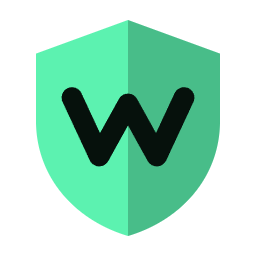
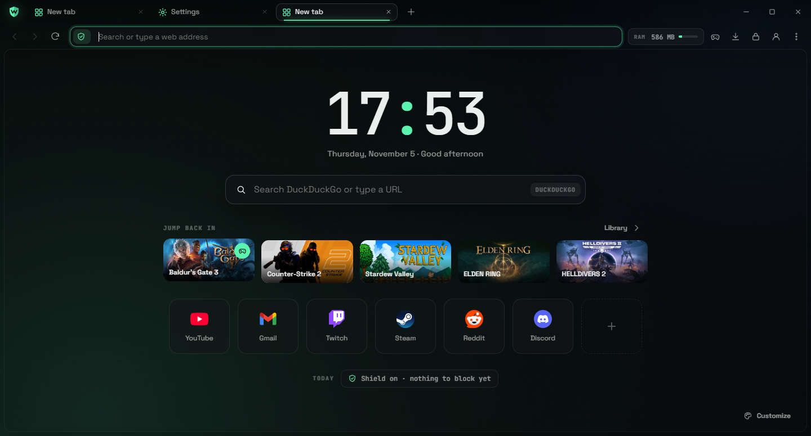
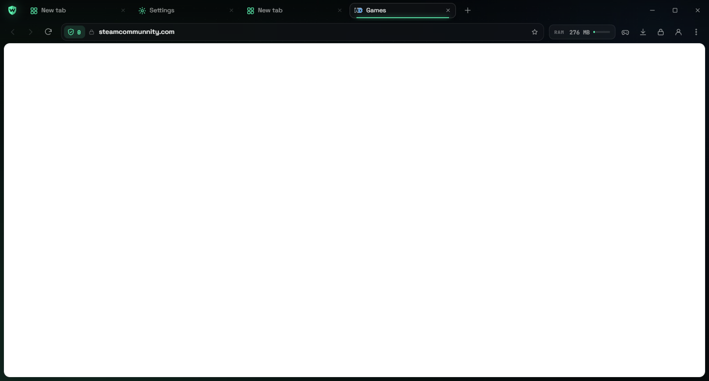
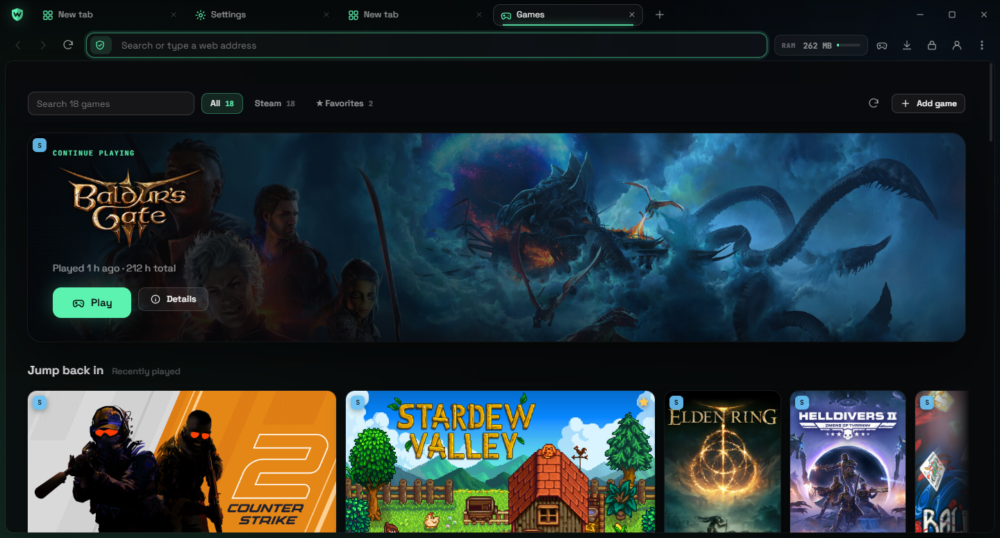
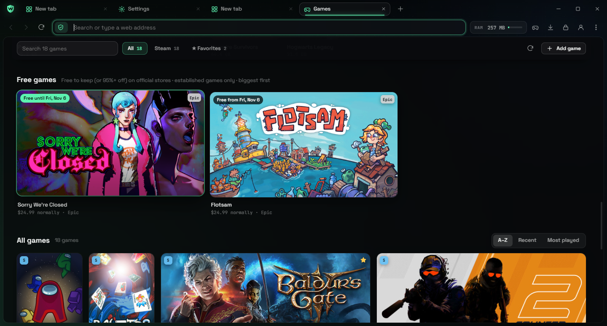
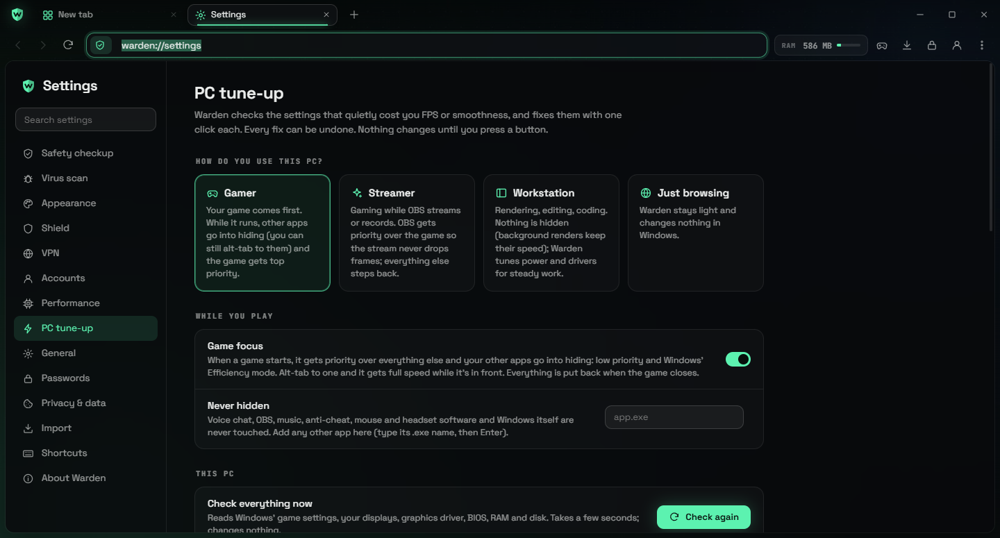
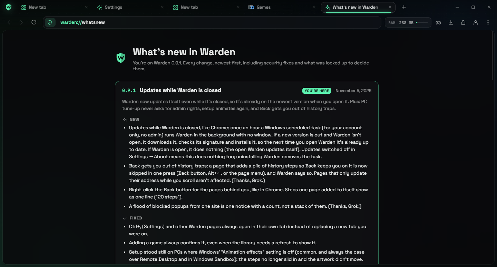
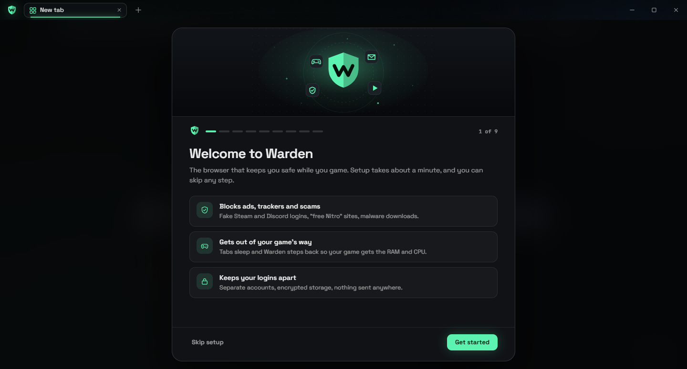
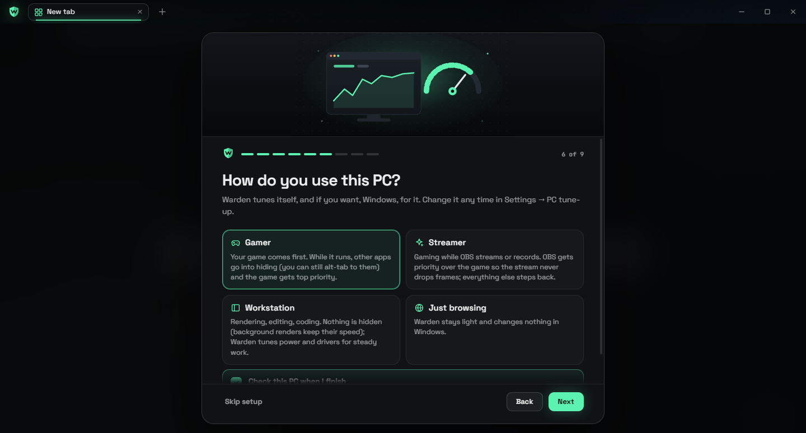
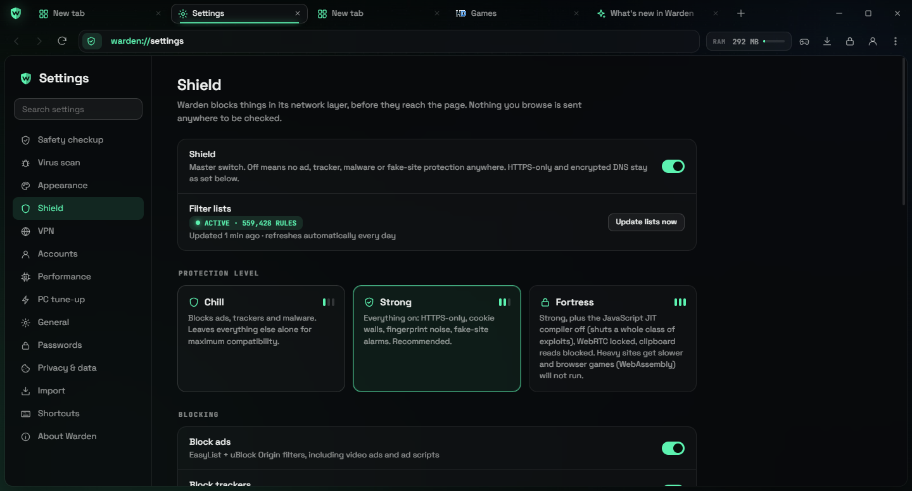

  

<h1 align="center">Warden Browser</h1>

  <b>The ad-free, scam-proof browser for gamers.</b> 
  Blocks ads, trackers, fake Steam and Discord logins and malware downloads, and steps out of the way when you play.

  
  
  
  

  <a href="../../releases/latest"><b>⬇ Download Warden for Windows</b></a>
  &nbsp;·&nbsp; <a href="CHANGELOG.md">Update log</a>
  &nbsp;·&nbsp; <a href="SECURITY.md">Security</a>

  

---

## What is Warden?

Warden is a desktop web browser for Windows, built on Chromium, the same engine as Chrome and Edge, so sites work the way you expect. It's made for people who game: the scams that target gamers (fake Steam trade pages, "free Nitro", fake download sites for popular tools) are blocked before they load. Your browser also gets out of your game's way, freeing up RAM and CPU while you play.

There's no account to make, no ads, and nothing you browse is sent anywhere to be checked.

## Highlights

### 🛡️ Protection that's on from the first second
- **Ad and tracker blocking** with uBlock Origin's and EasyList's filters (over 500,000 rules), YouTube ads included.
- **Fake-site alarms.** Look-alike addresses such as `steamcommunnity.com` get a warning with a button to the real site.
- **Gamer scam protection**: Discord and Steam phishing lists, "paste this into Win+R" (ClickFix) pages, fake login pop-ups drawn inside a page, QR-code login scams, and clipboard hijackers that swap wallet addresses or trade links.
- **Fake virus warnings stopped.** Tech-support scam pages ("your PC is locked, call Microsoft") get a red warning; if one took over the screen, Warden takes it out of full screen and mutes it. Esc always gets you out of a full-screen page.
- **Download quarantine.** Every download waits in a private folder while Microsoft Defender scans it. Programs and scripts (.exe, .msi, .bat…), cheats, cracks, injectors and password-locked archives stay held until you release them yourself, even after a clean scan. If Defender is off or replaced by another antivirus, Warden can't scan: ordinary files go to your Downloads folder (where your antivirus checks them) and programs, cheats and locked archives are still held.
- **HTTPS-only**, encrypted DNS, fingerprinting noise and cookie-banner removal.

  

### 🎮 Built around your games
- **Games tab** (Ctrl+G): your Steam, Xbox / Game Pass, Epic, Riot and Roblox games in one library with real cover art from every store, sorted into rows (Jump back in, Favorites, Most played, Rediscover, Never played). The games that matter get big wide artwork, the rest are posters.
- **Free games, with a standard**: the biggest games that are free right now (or 95%+ off) on Steam, Epic, Xbox and GOG. Only the major stores, only games with real player counts, links checked to be the store's own: no shovelware, no shady key sites.
- **Game mode**: while you play, Warden sleeps its tabs, lowers its own CPU priority and frees memory.
- **Game focus**: pick Gamer, Streamer or Workstation. While a game runs, your other apps step back (low priority plus Windows' Efficiency mode) and the game comes first; alt-tab to any app and it gets its speed back while it's in front. Streamers: OBS gets priority over the game, so the stream doesn't drop frames. Voice chat, music, anti-cheat and mouse/headset software are never touched.
- **PC tune-up**: finds the Windows settings that quietly cost FPS (Game Mode, background recording, windowed-game optimizations, mouse acceleration, power plan, GPU scheduling) and a monitor left at 60 Hz that can do more, and fixes each with one click, with Undo. It also checks how old your graphics driver and BIOS are, RAM speed (XMP/EXPO) and free disk space, and points you to the maker's own tools. It never turns off Windows security for speed.
- **Sidecar** (Alt+Shift+C): a small always-on-top window for a guide, map or stream next to your game.
- **Summon** (Alt+Shift+W): show or hide Warden from anywhere.

  

  

  

### 👤 Several accounts, one window
- Keep your main Gmail, school account, alt and gaming logins apart in **spaces**, each with its own sign-ins and cookies, like Chrome profiles but in one window.
- The account button shows your Google picture and name, so you always know which account a tab is using.

### 🔑 Passwords done properly
- **Bitwarden**, an audited open-source password manager, is built in and picked by default (Ctrl+Shift+L).
- Warden also has its own simple manager, encrypted with Windows, and it tells you honestly that Bitwarden is the safer choice.

### 🎬 Netflix, Spotify and Disney+ work
Streaming sites open in **Warden Media**, a separate copy signed for protected video (Widevine). That way the main Warden keeps all of its security switches on.

### 🔄 Updates itself, like Chrome
Warden downloads new versions in the background and installs them when you close it. Even while it's closed, an hourly background check (a Windows scheduled task for your account, like Chrome's updater; no admin) fetches and installs a new version, so Warden is already up to date when you open it. If it never closes properly (the PC shut down with it open), the update installs the next time it opens; left open for days, it updates itself once the PC has been idle for 20 minutes, and your tabs come back. After an update it shows you exactly what changed, including security fixes.

  

## Install

1. Go to **[Releases](../../releases/latest)** and download **`Warden-Setup-<version>.exe`** (about 210 MB).
2. Run it. It installs just for you, with **no admin prompt**, and adds Start menu and desktop shortcuts.
3. Windows may show **"Windows protected your PC"**. Warden isn't code-signed yet, and SmartScreen warns about apps it hasn't seen many times before. Click **More info**, then **Run anyway**.
4. A one-minute setup brings over your bookmarks from Chrome, Edge or Opera, signs you in to Google if you want, asks whether you game, stream or work (so Warden can tune your PC for it), and picks your look. Every step can be skipped.

**Already have Warden?** You never need to download it again: it updates itself.

**Requirements:** Windows 10 or 11, 64-bit.

  
    
  

## How updates stay safe

Automatic updates are an attractive target, so Warden is strict about them:

- Every release's description is **signed** with a private key that never leaves the developer's PC. Warden checks the signature against a public key built into the app.
- The downloaded installer must match that signed description's **SHA-256 fingerprint** byte for byte, and its exact size.
- Installers are only accepted from **this repository's own releases** (it was called `warden-updates` until November 2026; GitHub forwards the old links, which is why update files still point at that name), downloaded without cookies in a separate session.
- **No downgrades**: an older version is never installed, so an old release with known bugs can't be replayed.

A hacked download server, a fake Wi-Fi network or a corrupted download can't get anything installed: each fails one of those checks and is thrown away. Updates can be turned off in **Settings → About**. More in [SECURITY.md](SECURITY.md).

  

## FAQ

**Is it really Chromium?**
Yes. Warden runs on Electron, which ships Chromium, the open-source engine behind Chrome and Edge. Sites, logins and video work like they do in Chrome. Engine security patches are checked every week and go out as automatic updates.

One exception: Netflix, Spotify, Disney+ and other streaming sites open in **Warden Media**, which runs castlabs' Widevine build of Electron. castlabs ships a little behind (Electron 44, Chromium 152 right now), so that copy is locked down to streaming sites only: no downloads, no other sites, its own logins.

**Is it safer than Chrome?**
For the things gamers actually run into, like fake download sites, fake Steam/Discord logins and scam pages, Warden blocks a lot that Chrome lets through. Chrome still has a far bigger security team and gets Chromium's patches a few days earlier. The best setup in any browser is 2-Step Verification on your accounts plus a real password manager like Bitwarden.

**Does Warden collect my data?**
No. There's no Warden account, no analytics and no telemetry, and blocking happens on your PC. Besides the sites you visit, Warden only fetches filter-list updates, its own update check here on GitHub, and things you see in it, like game cover art, site logos and search suggestions (sent without your cookies).

**Can I import my Chrome stuff?**
Yes: bookmarks, history and top sites from Chrome, Edge, Brave, Vivaldi, Opera / Opera GX and Firefox, plus passwords from most password managers.

**Is it free?**
Yes.

**How do I uninstall it?**
Windows Settings → Apps → Warden → Uninstall. It asks before deleting your bookmarks and settings.

**Something's broken or a site doesn't work.**
[Open an issue](../../issues/new) with the site and what happened. For a security problem, please follow [SECURITY.md](SECURITY.md) instead.

## Update log

Every release is listed in **[CHANGELOG.md](CHANGELOG.md)**, newest first: what's new, what's fixed, security fixes, and the sources checked before each decision. The same log opens inside Warden after every update.

---

  Built on <a href="https://www.electronjs.org/">Electron</a> and <a href="https://www.chromium.org/">Chromium</a> ·
  ad blocking by <a href="https://github.com/ghostery/adblocker">Ghostery's adblocker engine</a> with <a href="https://github.com/uBlockOrigin/uAssets">uBlock Origin</a> and <a href="https://easylist.to/">EasyList</a> filters ·
  protected video by <a href="https://github.com/castlabs/electron-releases">castlabs</a>

